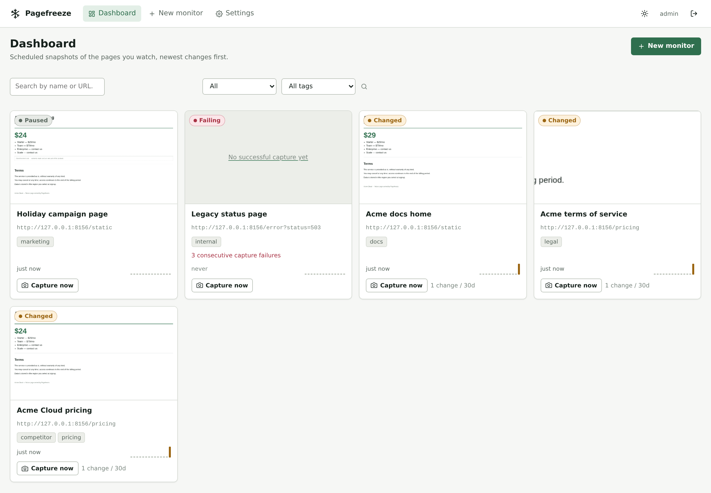
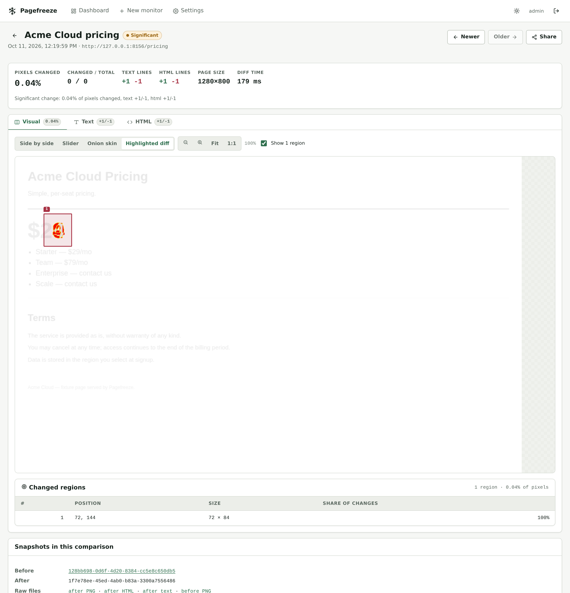

# Pagefreeze

**Watch any web page and see exactly what changed.**

Pagefreeze takes screenshots of web pages on a schedule and shows you the difference
between them: changed areas in the screenshot, changed words in the text, and changed
HTML. It can notify you by webhook, Slack or email when something changes.

It is self-hosted: one Docker container plus a PostgreSQL database. No external services,
no tracking.





More screenshots are in [`docs/images/`](docs/images/).

## What you can use it for

- Track a competitor's pricing page
- Get alerted when terms of service or policies change
- Catch unexpected changes on your own website after a deploy

## Features

- **Visual diff** – compare screenshots side by side, with a slider, as an overlay, or with
  changed areas highlighted
- **Text and HTML diff** – see which words or markup changed
- **Schedules** – every 15 minutes, hourly, daily, weekly, or a custom cron expression
- **Ignore noisy parts** – skip things like timestamps, cookie banners or ads using CSS
  selectors
- **Notifications** – webhooks, Slack and email
- **Share links** – send a read-only link to one change, with an expiry date
- **REST API** – everything in the UI is also available over the API
  ([api/openapi.yaml](api/openapi.yaml))
- **Light and dark mode**, works on mobile

## Getting started

You need **Docker** and **Docker Compose**.

**1. Download the project**

```console
git clone https://github.com/zahidhasann88/pagefreeze.git
cd pagefreeze
```

**2. Create your settings file**

```console
cp .env.example .env
```

Open `.env` and fill in these three values:

| Setting                     | What to put                                                |
| --------------------------- | ---------------------------------------------------------- |
| `PAGEFREEZE_ADMIN_PASSWORD` | The password you will use to sign in                       |
| `PAGEFREEZE_SECRET_KEY`     | A random key – generate one with `openssl rand -base64 32` |
| `POSTGRES_PASSWORD`         | Any strong password for the database                       |

**3. Start it**

```console
docker compose up -d
```

**4. Open it**

Go to <http://localhost:8080>, sign in as `admin` with your password, and add your first
monitor.

## How it works

1. You add a **monitor**: a URL plus a schedule.
2. On each run, Pagefreeze opens the page in a real browser and saves a **snapshot**
   (screenshot, text and HTML).
3. It compares the new snapshot with the previous one. If enough has changed, it records a
   **change** and sends your notifications.

You can set how much the screenshot must change before it counts (default 0.5%). Text
changes always count, so a price going from 9 to 19 is never missed.

If a page fails to load 3 times in a row you get one alert, and another when it recovers.
Old snapshots are deleted after 90 days by default; the latest one is always kept.

## Configuration

All settings are environment variables in your `.env` file. The common ones are explained
in [.env.example](.env.example), and the full list is in
[docs/configuration.md](docs/configuration.md).

## Backups

Back up two things together:

1. **The database** – for example with `pg_dump -Fc`
2. **The data folder** (`/data` in Docker) – screenshots, HTML, text and diff images

Also keep a copy of your `.env` file. Without `PAGEFREEZE_SECRET_KEY` you cannot read
saved headers, cookies or webhook secrets.

## Security

Pagefreeze opens URLs in a real browser, so it blocks requests to private and internal
addresses (like `localhost` or `169.254.169.254`) by default. Saved headers, cookies and
webhook secrets are encrypted. Captured pages are always shown as plain text, never run.

Snapshots may contain private data if you monitor pages behind a login, so protect your
database and data folder.

See [SECURITY.md](SECURITY.md) for details and how to report a vulnerability.

## Limitations

- Pages built heavily with JavaScript may need a wait setting or extra delay to capture
  correctly.
- CAPTCHAs and bot protection are not bypassed.
- Login flows (forms, OAuth, 2FA) are not supported – only fixed headers and cookies.
- There is one admin account.

## Development

Requirements: Node 20 or 22, pnpm 9, and PostgreSQL.

```console
pnpm install
pnpm demo         # demo site with live changes on :8080 (login admin / pagefreeze-demo)
pnpm dev          # server on :8080
pnpm dev:web      # web UI dev server on :5173
pnpm test         # run tests
pnpm lint && pnpm typecheck
```

Run `playwright install chromium` once before capturing pages locally.

## License

MIT – see [LICENSE](LICENSE).
