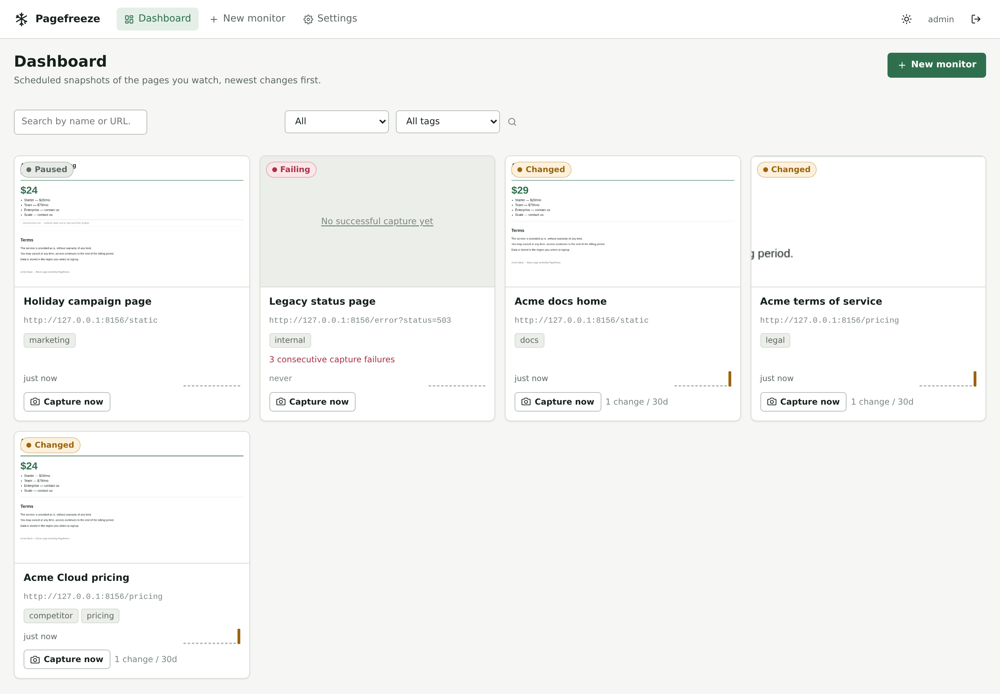
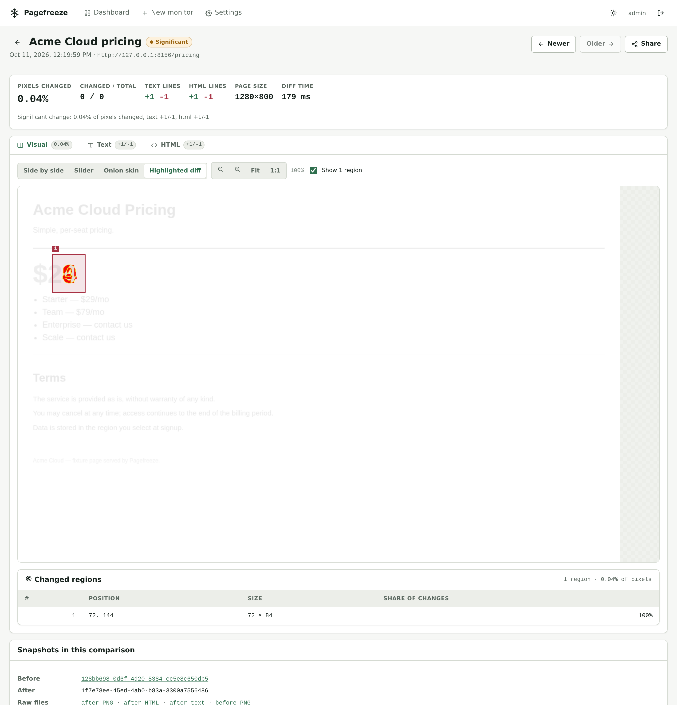
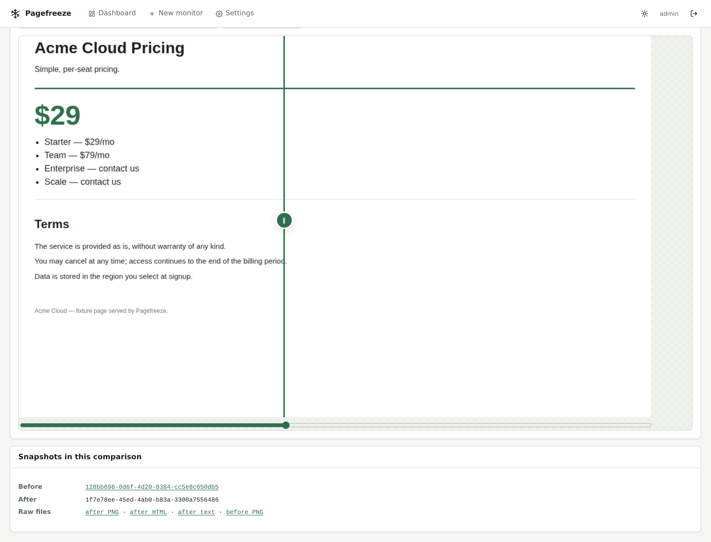
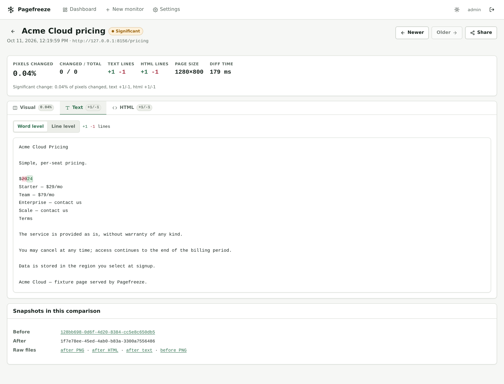
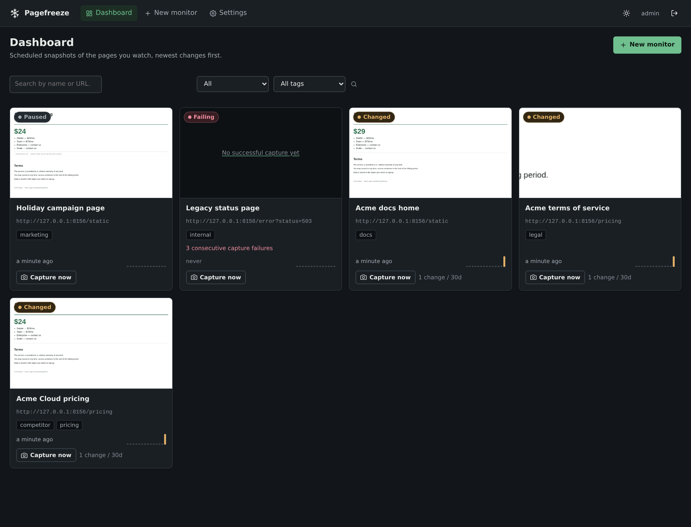
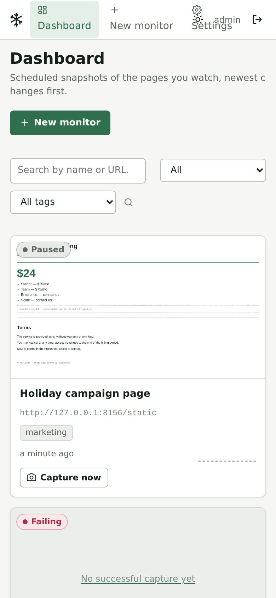

# Pagefreeze

**See exactly what changed on any web page — screenshots, text and HTML, compared on a schedule, with notifications when something moves.**

Pagefreeze takes scheduled snapshots of the pages you care about and shows you the
difference: a pixel-level visual diff with the changed regions boxed, a word-level text
diff, and a diff of the normalised markup. Watch a competitor's pricing page, your terms of
service, a docs site, or your own site for unintended changes.

Self-hosted. One container plus PostgreSQL. No external services, no telemetry, no CDN —
it runs fine on a machine with no internet access at all.

---

## Screenshots

|                                                                                                |                                                                                      |
| ---------------------------------------------------------------------------------------------- | ------------------------------------------------------------------------------------ |
|                                                         |               |
| _The dashboard: every monitor with its latest screenshot, status, sparkline and change count._ | _The change viewer: pixel diff with changed regions boxed, plus text and HTML tabs._ |

|                                                      |                                                  |
| ---------------------------------------------------- | ------------------------------------------------ |
|  |  |
| _Before/after wipe._                                 | _Word-level text diff._                          |
|          |       |
| _Dark mode follows your OS preference._              | _Responsive down to phone widths._               |

More in [`docs/images/`](docs/images/): `login`, `monitor-detail`, `monitor-form` (with a
live test capture), `change-viewer-side-by-side`, `change-viewer-onion`,
`change-viewer-html`, `compare`, `settings`, `share`, `change-viewer-diff-dark`.

**Regenerating them.** Every image above is a real screenshot of a real capture run — no
mocks, no placeholders. To regenerate after changing the UI:

```console
pnpm install
pnpm screenshots          # builds the SPA, boots the demo stack, drives it with Playwright
```

The script (`packages/server/src/scripts/screenshots.ts`) starts the fixture website, seeds
monitors, performs real captures with a real change in between, and saves the result to
`docs/images/`. Commit the output. Requirements: a reachable PostgreSQL
(`DATABASE_URL_TEST`) and `playwright install chromium`.

---

## The problem

Pages change. A price goes up, a clause is rewritten, a button disappears, a deploy breaks
the checkout. You usually find out from a customer, or from a diff of two screenshots you
took months apart and never looked at again.

Existing answers are either heavyweight (full visual-regression suites aimed at CI),
opaque (SaaS that emails you "something changed" with no evidence), or fragile (curl +
grep). Pagefreeze aims at the middle: **proof, on your own infrastructure, of precisely what
changed and when.**

## Features

- **Visual diff** — pixelmatch over real Chromium screenshots, with four ways to look at it:
  side-by-side, a draggable before/after slider, an onion-skin opacity blend, and a
  highlighted diff with **changed regions clustered into bounding boxes** you can hover and
  list. Zoom and pan, keyboard included. Different page heights are handled by padding the
  smaller capture onto the larger canvas, and the size change is reported rather than
  hidden.
- **Text diff** — visible text (`document.body.innerText`), whitespace-normalised, compared
  line- and word-level with a unified patch. Pure whitespace churn is ignored.
- **HTML diff** — normalised markup (scripts, inline styles, nonces and `data-*` stripped)
  compared line-by-line with unchanged runs folded, so framework churn doesn't drown the
  real change.
- **Scheduling** — presets (15m / 1h / 6h / 24h / 7d) or any 5-field cron, with a
  human-readable description of every schedule in the UI and a configurable minimum
  interval so nobody monitors a site every sixty seconds.
- **Duplicate skipping** — when a capture is byte-identical to the previous one, no new
  files are written, no diff is computed, and the snapshot is recorded as unchanged.
- **Noise control** — per-monitor "ignore these selectors" (timestamps, cookie banners, ad
  slots) applied _before_ the screenshot and _before_ text/HTML extraction, so volatile
  content produces no false changes. Wait strategies (`load`, `networkidle`, a selector),
  extra delay, capture-only-this-element, device presets and custom viewports.
- **Notifications** — generic webhooks (HMAC-signed, replay-resistant), Slack-compatible
  incoming webhooks, and SMTP email. Attached per monitor. One alert per failure streak,
  one on recovery.
- **Share links** — unguessable, expiring, revocable, read-only URLs for showing one change
  to someone without an account.
- **Auth** — one admin account with a session cookie + CSRF, plus hashed API tokens for
  scripts. Bearer or cookie, your choice.
- **Public share view and a full REST API** with an OpenAPI spec generated from the same
  zod schemas that validate requests.
- **Observability** — `/healthz`, `/readyz`, Prometheus `/metrics`, structured logs with
  secret redaction.

## Quickstart

Requirements: Docker and Docker Compose.

```console
git clone https://github.com/zahidhasann88/pagefreeze.git && cd pagefreeze
cp .env.example .env
# then edit .env: PAGEFREEZE_ADMIN_PASSWORD, PAGEFREEZE_SECRET_KEY (openssl rand -base64 32),
# and POSTGRES_PASSWORD
docker compose up -d
```

Open <http://localhost:8080>, sign in, create a monitor. Done — three commands.

### Try it without pointing it at anything real

```console
pnpm install
pnpm demo
```

`pnpm demo` boots a fixture website that mutates on a timer, seeds two monitors, and runs
real captures against it on <http://localhost:8080> (login `admin` /
`pagefreeze-demo`). Within a minute you will see a change appear in the viewer. Needs a
local PostgreSQL (see `DATABASE_URL` in `.env.example`) and `playwright install chromium`.

## How monitors and diffs work

A **monitor** is a URL plus capture settings (viewport, device preset, wait strategy,
ignore selectors, capture selector, headers/cookies, User-Agent) plus a schedule and a
change threshold.

A **snapshot** is one capture: the screenshot PNG, the rendered HTML, the extracted visible
text, a SHA-256 of each, and the page's title, final URL, HTTP status and load timing.

A **change** compares a snapshot with the previous _successful_ snapshot of the same
monitor. It records the pixel-diff percentage and changed-pixel count, clustered change
regions, text and HTML line counts, whether the page size changed, and a **significant**
flag. A change is significant when the pixel diff meets the monitor's threshold, **or** when
text/HTML detection is on and content changed — a price going from `9` to `19` moves a
fraction of a percent of pixels and still matters enormously.

Failed captures are stored with their error and never produce a change. After
`PAGEFREEZE_FAILURE_NOTIFY_THRESHOLD` (default 3) consecutive failures you get one
notification, and one more when the monitor recovers.

Snapshots, changes and artefacts older than the retention window (default 90 days,
overridable per monitor) are deleted on a schedule; each monitor's newest successful
snapshot is always kept so a quiet monitor never loses its baseline.

See [docs/architecture.md](docs/architecture.md) for the full picture.

## Security model

Pagefreeze runs a real browser pointed at URLs you supply, which makes SSRF the
highest-risk area; it is treated accordingly.

- **Every request the browser makes is checked** — navigation, redirect hops, subframes and
  subresources — against scheme, hostname and _every resolved address_. Loopback, private,
  link-local (including `169.254.169.254`), carrier-grade NAT, multicast, reserved and
  IPv6 equivalents are refused. Unresolvable hostnames fail closed.
  `ALLOW_PRIVATE_TARGETS=true` opens this up; `PAGEFREEZE_ALLOWED_HOSTS=host:port` exempts
  exactly one host (the demo uses it) while every redirect away from it stays validated.
- **DNS rebinding is defeated** by routing captures through a loopback proxy that opens the
  socket itself, to the address the guard validated — the browser never resolves the
  hostname for the connection it uses.
- **Custom headers, cookies and webhook secrets are encrypted at rest** with AES-256-GCM.
  Only their _names_ are ever returned by the API.
- **Stored HTML and screenshots are third-party data.** They are served only as
  `text/plain` with `nosniff` and a `default-src 'none'; sandbox` CSP, and rendered in the
  UI as escaped text. There is no live iframe of captured content.
- Sessions are `httpOnly` + `SameSite=Lax` (+ `Secure` behind HTTPS) with double-submit
  CSRF; login is rate limited; API tokens are stored hashed.
- Restrictive CSP and security headers on every response. Webhook destinations go through
  the same SSRF guard and don't follow redirects by default.
- The default User-Agent identifies Pagefreeze so site operators can contact or block you.
  Please honour that: check the terms of any site you monitor.

**Stored snapshots may contain sensitive data.** If a monitored page sits behind a login,
its screenshots and extracted text contain whatever that session could see. Protect the
data directory and the database accordingly, and think before creating a share link.

Full detail, including the key-rotation limitation: [docs/security.md](docs/security.md).

## API

Everything the UI does is available over REST under `/api/v1`, documented in
[docs/api.md](docs/api.md) and in the generated [api/openapi.yaml](api/openapi.yaml).

```console
# create a token once, keep the value
curl -s -X POST http://localhost:8080/api/v1/auth/login \
     -H 'content-type: application/json' \
     -d '{"username":"admin","password":"'"$PAGEFREEZE_ADMIN_PASSWORD"'"}' -c /tmp/pfz.jar
curl -s -b /tmp/pfz.jar -H "x-csrf-token: $(grep pagefreeze_csrf /tmp/pfz.jar | awk '{print $NF}')" \
     -X POST http://localhost:8080/api/v1/tokens -H 'content-type: application/json' \
     -d '{"name":"ci","expiresInDays":90}'

# use it
curl -s -H "Authorization: Bearer $TOKEN" http://localhost:8080/api/v1/monitors
curl -s -X POST -H "Authorization: Bearer $TOKEN" \
     http://localhost:8080/api/v1/monitors/<id>/capture
```

## Configuration

Every setting is an environment variable; the full table is in
[docs/configuration.md](docs/configuration.md) and mirrored in [.env.example](.env.example).
The three you must set in production: `PAGEFREEZE_ADMIN_PASSWORD`,
`PAGEFREEZE_SECRET_KEY` (`openssl rand -base64 32`), and a database URL.

## Scaling

- **Split API and workers.** `PAGEFREEZE_MODE=api` runs HTTP only (no Chromium); `worker`
  runs the scheduler and captures only. Scale API replicas behind a load balancer and add
  workers for capture throughput; pg-boss singleton keys guarantee a monitor is never
  captured twice concurrently, even across instances.
- **Browser concurrency** is `PAGEFREEZE_CAPTURE_CONCURRENCY` (default 2). Chromium is the
  dominant cost: roughly 2 concurrent captures per 4 GB of RAM is comfortable. Queued
  captures wait rather than fail.
- **Disk.** Budget per snapshot: a full-page 1280-wide screenshot is typically 100–500 KB
  PNG, the stored HTML 50–500 KB, the text 10–100 KB; a change adds a diff PNG of similar
  size. At one capture per hour with 90-day retention that is on the order of
  2–10 GB per monitor — monitor a handful of pages, not thousands, or lower the retention.
  Duplicate captures cost nothing extra.
- **Database** load is modest: a few rows per capture. Postgres 13+ works; 17 is what CI uses.

## Backup

Two things hold your history:

1. **The database** — monitors, snapshots, changes, tokens, sessions.
   `pg_dump -Fc` on a schedule; it is the source of truth for everything except pixels.
2. **The data directory** (`PAGEFREEZE_DATA_DIR`, `/data` in the compose file) — screenshots,
   stored HTML, text and diff images.

Back up both, together, from a consistent point in time (stop the worker, or take the
database dump first and accept a tiny window). Restoring only the database leaves rows
pointing at missing files; restoring only the directory leaves files nobody knows about —
the retention job will eventually delete those as orphans.

## Limitations

- **Heavy client-rendered sites** may capture before their framework finishes painting. Use
  the `selector` wait strategy or `extraDelayMs`; there is no way to make an arbitrary SPA
  deterministic.
- **Bot protection and CAPTCHAs are not defeated, by design.** If a site blocks automated
  browsers, ask for permission or use its API instead.
- **Interactive authentication is unsupported.** Only static headers and cookies. No OAuth
  redirects, no 2FA flows, no login forms.
- **One admin account.** No multi-user authorisation; share links are the (deliberately
  narrow) way to let someone else see a change.
- **No key rotation** for `PAGEFREEZE_SECRET_KEY` yet — changing it orphans stored secrets.
  See [docs/security.md](docs/security.md#key-rotation--a-documented-limitation).
- **Login rate limiting is per-process**, so several API replicas each keep their own
  counter.

## Roadmap

- **S3-compatible storage** behind the existing `StorageProvider` interface (the local
  filesystem is the only implementation today; nothing outside `src/storage/` touches files).
- **Multi-user** accounts with roles, and per-user notification preferences.
- **Element-level monitoring** as a first-class monitor type (today: `captureSelector`).
- **Visual regression baselines** — approve a capture as the reference and diff against it,
  for design-system work rather than change detection.
- Key rotation with versioned envelopes.
- A real OpenAPI client generated from `api/openapi.yaml`.

## Development

```console
pnpm install
pnpm dev          # server with migrations + scheduler on :8080
pnpm dev:web      # Vite dev server on :5173 with API proxying
pnpm test         # unit + integration + web component tests
pnpm test:e2e     # one Playwright end-to-end test against a live stack
pnpm lint && pnpm typecheck && pnpm coverage
```

Node 20 or 22, pnpm 9. See [CONTRIBUTING.md](CONTRIBUTING.md) for the workflow and
[docs/architecture.md](docs/architecture.md) for the lay of the land.

## License

MIT — see [LICENSE](LICENSE).
